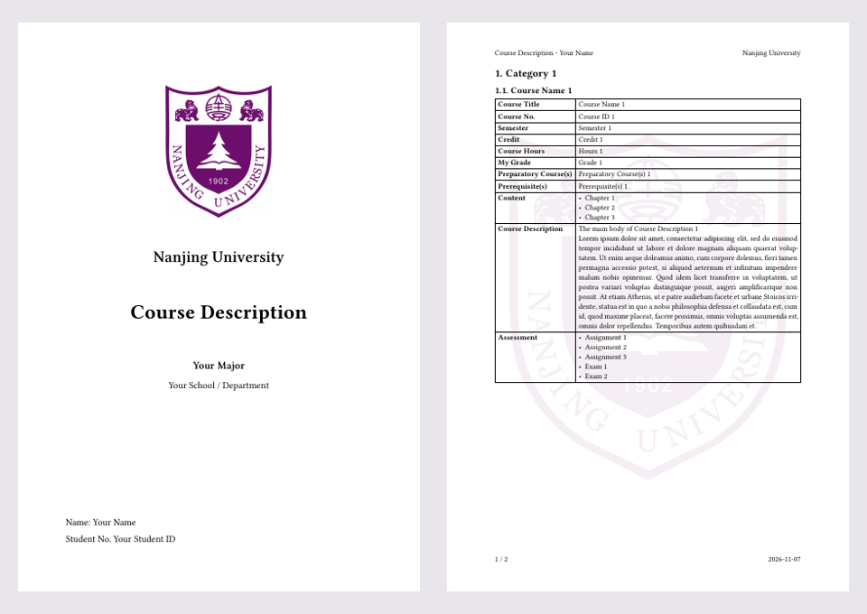

# NJU Course Description Template · 南京大学课程描述模板

面向南京大学同学的 **Typst 英文课程描述模板**，适合在海外升学申请时整理课程信息。基于 [dsyislearning 的北邮模板](https://github.com/dsyislearning/typst-course-description-template) 改编，加入南大校徽、淡色水印和可填写的学制、毕业学分说明。

An applicant-prepared Typst template for Nanjing University students to prepare English course descriptions for university applications.

## 预览



[查看完整示例 PDF](main.pdf) · [下载 PDF](https://github.com/cator1/nju-course-description-template/raw/refs/heads/main/main.pdf)

示例中的姓名、学号、专业、课程及成绩均为占位内容，不包含真实个人申请材料。

## 快速开始

### 方法一：Typst 网页编辑器

1. 在 [Typst](https://typst.app/) 新建项目。
2. 上传 `main.typ`、`template.typ`、`logo_nju.jpg` 和 `logo_nju_watermark.svg`，保持在同一目录。
3. 打开 `main.typ`，填写个人信息和课程内容，导出 PDF。

### 方法二：本地编译

安装 [Typst CLI](https://github.com/typst/typst#installation)，下载本仓库，然后在文件所在目录运行：

```bash
typst compile main.typ main.pdf
```

模板使用 `Libertinus Serif`。如本地提示字体缺失，可安装该字体，或在 `template.typ` 中改为已安装的英文字体。

## 需要修改的内容

在 `main.typ` 开头填写：

```typst
major: "Your Major",
school: "Your School / Department",
name: "Your Name",
id: "Your Student ID",
duration: "Your standard programme duration",
total_credits: "Your required local credits",
```

- 姓名、专业和学院英文名称应与自己的正式申请材料保持一致。
- 学制及毕业总学分应使用本人年级、专业适用的培养方案，不能直接用目前已修学分代替。
- 课程名称、代码、学期、学分、成绩以成绩单为准；课程内容参考本人实际修读的大纲、周历和教学资料。
- 模板保留本校学分；如申请方要求 ECTS，应依据对方的换算规则另行说明，不能套用他人的固定比例。

## 增加课程和分类

用一级标题添加分类，例如 `= Mathematics`，再复制一个 `#course(...)` 条目。函数支持以下字段；不需要的字段可以整行删除。

| 字段 | 内容 |
|---|---|
| `name` / `id` | 课程名称 / 代码 |
| `semester` / `credit` | 学期 / 本校学分 |
| `hours` / `grade` | 学时 / 成绩 |
| `preparatory` / `prerequisite` | 预备课程 / 先修要求 |
| `content` | 教学主题 |
| `description` | 课程描述 |
| `assessment` | 考核方式 |

示例里的 `#lorem(100)` 只是排版占位，使用前请删除并填写真实内容。添加或删除课程后，目录与页码会在编译时更新。

## 文件说明

| 文件 | 用途 |
|---|---|
| `main.typ` | 个人信息与示例课程，主要编辑入口 |
| `template.typ` | 封面、学分说明、目录、页眉页脚和课程表格排版 |
| `main.pdf` | 用占位内容编译的完整预览 |
| `logo_nju.jpg` | 封面校徽 |
| `logo_nju_watermark.svg` | 7% 不透明度的校徽水印 |
| `preview.png` | README 页面预览 |

## 来源与说明

- 原始设计与 Typst 模板：[dsyislearning/typst-course-description-template](https://github.com/dsyislearning/typst-course-description-template)。感谢原作者提供底稿。
- 南大校徽来源：[南京大学档案馆](https://dawww.nju.edu.cn/info/3061/69011.htm)。校徽相关权利归原权利人所有。
- 这是学生整理的排版模板，**不是南京大学官方课程大纲或认证文件**。申请学校对内容、翻译和盖章的要求请自行核对。
- 本仓库未另行添加覆盖上游代码或校徽的开源许可证。

欢迎通过 Issues 或 Pull Requests 提交排版改进与使用经验；请勿在公开讨论中上传身份证件、完整成绩单等私人申请材料。
